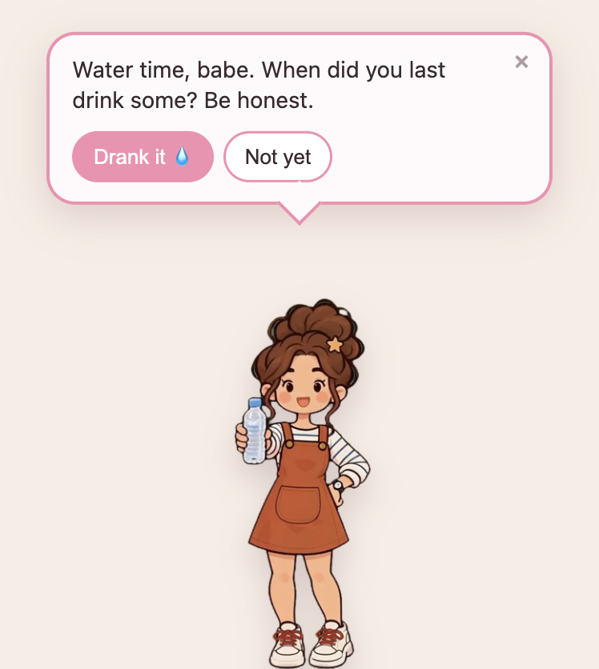
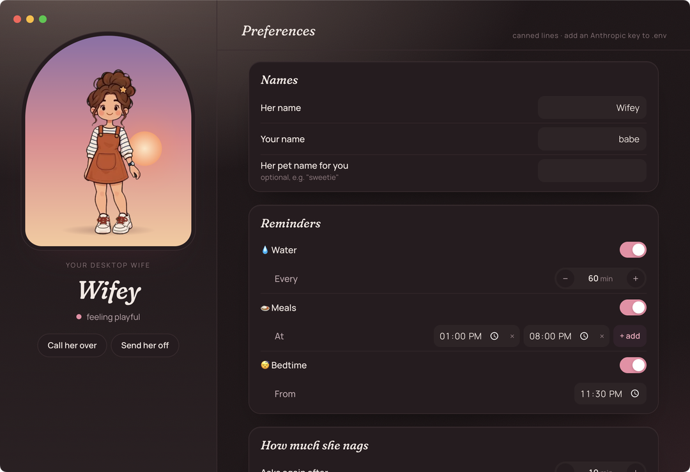
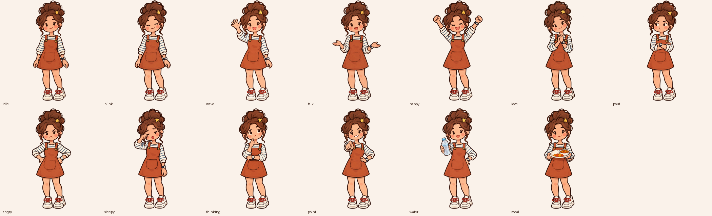

# desktop-wifey 💕

A tiny cartoon wife who lives on your Mac and makes sure you don't die at your desk.

She drops in from the top of your screen, waves a water bottle at you, brings you a plate when
it's lunchtime, and tells you to go to bed when it's 1am and you're "just fixing one more thing".
Ignore her and she pouts. Ignore her again and it's hands-on-hips, "did you forget you have a
wife?!" energy. Drink the water and she's so proud of you.

She thinks with Claude, talks with ElevenLabs (optional), and moves with little AI-made clips.
No account, no server, no tracking. She just lives on your desktop and judges your hydration.

<p align="center">
  
</p>

> She ships with a sample character so it works the second you clone it. Want her to look like
> your actual partner (or your cat, or a potato)? See [Make your own character](#make-your-own-character).

## What she does

- 💧 **Water, meals, bedtime.** Hourly water, meals at your times, bedtime at night. Each one is a
  little speech bubble with **Drank it** / **Not yet**. She holds out a bottle or a plate when she
  asks nicely.
- 😤 **Nags, with feelings.** Snooze her and she comes back pouty. Snooze her twice and she's
  properly annoyed. Give up on her and she gives up on you (for a bit).
- 🥰 **Pet her.** Click her for hearts and a flustered reaction. Drag her somewhere and that's her
  new spot. Double-click to open her window.
- ⌨️ **Summon her.** **⌥⌃W** from anywhere and she runs over, to whichever screen you're on.
- 🧠 **She improvises.** With an Anthropic key every line is made up on the spot, in character.
  Without one she uses built-in lines, so she always works.
- 🔊 **She talks (optional).** With an ElevenLabs key she says her lines out loud, and sounds the
  way she feels: sulky when she's sulking, sleepy at midnight.
- 🤫 **She knows when to shut up.** Quiet hours, a pause button, and she hides by herself during
  Meet, Zoom, Teams and FaceTime calls.
- 🖥️ **Multiple screens.** She shows up on the screen you're using and remembers a home spot on
  each one.

She lives in the menu bar as 💕 (💤 while she's paused).

## Quick start

You need macOS, Node 20+ and npm.

```bash
git clone https://github.com/0xindiebruh/desktop-wifey.git
```

```bash
cd desktop-wifey && npm install
```

```bash
cp .env.example .env
```

Open `.env`, put in her name and yours, and (optionally) your `ANTHROPIC_API_KEY`. Then:

```bash
npm start
```

She'll wave hello in a second or two. Want to see a reminder right now instead of waiting an hour?

```bash
WIFEY_DEMO=water npm start
```

(`meal` and `bedtime` work too.) Or use 💕 → **Demo** in the menu bar.

To build a real `.app`:

```bash
npm run make
```

It ends up zipped in `out/`. It's unsigned, so the first time macOS will want you to right-click →
**Open**.

## Configuration

Two places, both boring in a good way:

- **Her window** (double-click her, or 💕 → **Open Wifey…**): names, reminder times, how much she
  nags, quiet hours, her size, the summon shortcut, voice on/off and volume, open at login. Changes
  apply instantly. They're saved to `~/Library/Application Support/desktop-wifey/settings.json`.

  

- **`.env`**: API keys, her ElevenLabs voice, the Claude model, and first-launch defaults for the
  stuff above. See [`.env.example`](./.env.example) for every option. The packaged app reads
  `~/Library/Application Support/desktop-wifey/.env` instead.

| Key                  | What for                            | Needed?                     |
| -------------------- | ----------------------------------- | --------------------------- |
| `ANTHROPIC_API_KEY`  | Her brain (Claude)                  | No, canned lines without it |
| `ELEVENLABS_API_KEY` | Her voice                           | No, she's silent without it |
| `FAL_KEY`            | Making clips for your own character | Only for `npm run clips`    |

## What it costs

- **The app:** free, MIT.
- **Claude:** one short call per line she says (a few dozen a day). Cheap, but it's your API bill.
  Set `WIFEY_MODEL` in `.env` if you want a smaller model.
- **ElevenLabs:** optional. Lines are short, and repeats are cached.
- **Your own character's clips:** a one-time ~$4-6 on fal.ai for all 13 clips with MiniMax H3 at
  768p ($0.06 per second of video). Run `npm run clips -- --dry --all` to see the estimate before
  you spend anything. The sample character's clips are already in the repo.

## Make your own character

The app looks for art in this order and uses the first folder that has an `idle.png`:

1. `~/Library/Application Support/desktop-wifey/art/` (handy for the packaged app)
2. `art/private/` (gitignored, so your partner's face never ends up on GitHub)
3. `art/sample/` (the sample character that ships with the repo)

Characters never mix: if your folder is missing a pose, she uses a drawn placeholder for it, not
the sample's.

### 1. The poses

You need 13 transparent PNGs, all the same size (1024×1024), same character, same framing, feet at
the same height: `idle`, `blink`, `wave`, `talk`, `happy`, `love`, `pout`, `angry`, `sleepy`,
`thinking`, `point`, `water` (holding a bottle out) and `meal` (holding a plate out).

Here's the sample character's set, for reference:



Easiest way: one ChatGPT (or Codex) conversation, idle first, then every other pose as an edit of
it. The exact prompts are in [`art/PROMPT.md`](./art/PROMPT.md), and the brief (what each pose is
for) is in [`art/POSES.md`](./art/POSES.md). Drop the files in `art/private/` and restart. She's
in.

### 2. The moves (optional)

Stills are fine. Clips are better. `npm run clips` sends each pose to MiniMax H3 on fal.ai on a
green screen, keys the green out with ffmpeg, and saves a transparent WebM the app plays instead of
the still. Needs `FAL_KEY` in `.env` and `ffmpeg` (`brew install ffmpeg`).

```bash
npm run clips -- --dry --all
```

```bash
npm run clips -- --all
```

```bash
node scripts/split-run.mjs
```

The first shows the plan and the estimated cost. The second makes every clip (raw videos are
cached in `art/private/clips/raw/`, so you never pay twice). The third cuts the one long run take
into `run-start`, `run` and `run-stop`. If the keying looks off, redo just that part for free:

```bash
npm run clips -- wave --rekey
```

Prompts live in [`art/clips.json`](./art/clips.json) (H3 is picky about durations: 5 and 8
seconds work, 4 doesn't). Your run take is different from the sample's, so measure how far her feet
travel and paste the numbers it prints into [`src/renderer/gait.ts`](./src/renderer/gait.ts), or
her feet will slide:

```bash
node scripts/gait.mjs
```

## Security

- Keys live only in `.env`, which is gitignored. Nothing else ever stores them.
- She doesn't open any network port. The only things she talks to are Anthropic and ElevenLabs
  (if you gave her keys), and fal.ai when you run the clip scripts yourself.
- Everything she remembers (settings, mood, when you last drank water) stays in
  `~/Library/Application Support/desktop-wifey/`.

## Roadmap

- 📱 **A phone app for the real her.** So your partner can send messages that pop up on your
  screen, see whether you've actually been drinking water, and set the cartoon's mood from wherever
  she is. Coming someday.
- Windows and Linux. The code is Electron, so mostly it's "someone has to try it".

PRs welcome. Keep her wholesome.

## For AI agents

Working on this repo with Claude Code, Codex or similar? Read [`AGENTS.md`](./AGENTS.md) first.
There's also an [`llms.txt`](./llms.txt).

## License

MIT © AppMacha Labs. See [`LICENSE`](./LICENSE).
